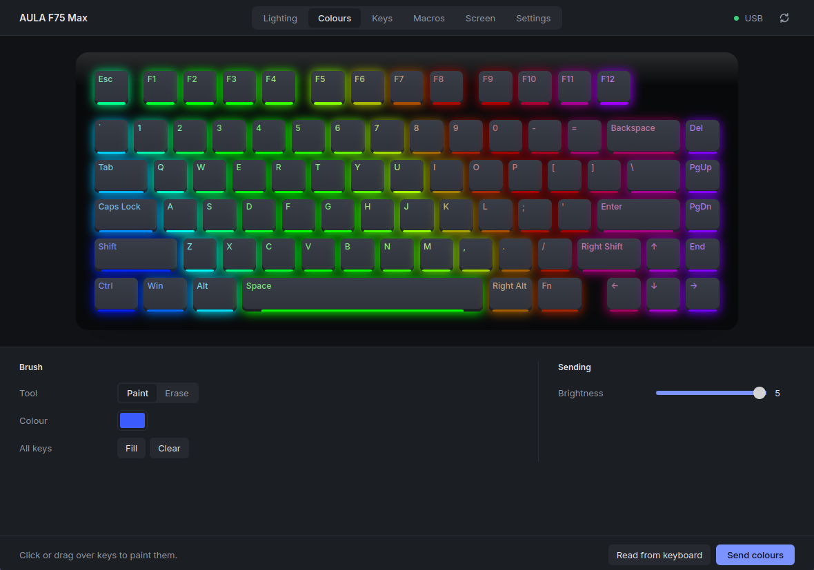

# EPOMAKER x AULA F75 Max on Linux

Configure the EPOMAKER x AULA F75 Max keyboard from Linux: lighting, per-key colours, key
remapping, macros, the 128x128 screen and the firmware settings, over USB or the 2.4 GHz
dongle. Over the dongle, only lighting and the battery level are checked on a keyboard so far.



This is an unofficial project, not affiliated with EPOMAKER or AULA. The protocol is described
in [`docs/protocol.md`](docs/protocol.md).

## Install

Building needs Rust 1.85 or newer. The desktop app also needs WebKitGTK 4.1 (`webkit2gtk-4.1` on Arch,
`libwebkit2gtk-4.1-dev` on Debian and Ubuntu).

Let your user open the keyboard's hidraw nodes, then plug it in again:

```sh
sudo install -m 644 udev/70-aula-f75.rules /etc/udev/rules.d/
sudo udevadm control --reload
```

Build:

```sh
cargo build --release                  # aulactl, in target/release
cargo build --release -p aula-gui      # the desktop app
```

## Desktop app

```sh
cargo run --release -p aula-gui
```

The keyboard cannot report its keymaps, macros or settings, so the app keeps what you set and
can send it all again with the resync button. Language and theme follow the system and can be
changed in the settings. The interface is in English, French, German, Spanish, Italian,
Japanese, Korean, and Simplified and Traditional Chinese.

## Command line

Commands that change the keyboard only print their reports unless given `--send`. `read-keys`,
`rainbow` and `battery` always talk to the keyboard.

```sh
aulactl list                                           # find the keyboard
aulactl lighting breath --color 3b5bfd --send
aulactl keys --all 000000 --key esc=ff0000 --send
aulactl macros "+lshift a 30ms -lshift" --send         # stored as macro 0
aulactl remap capslock=esc q=ctrl+c f1=macro:0 --send  # replaces the whole layer
aulactl settings --disable-win --sleep 5m --send
aulactl screen animation.gif --send                    # USB only, about 1 s per frame
aulactl battery                                        # dongle only
```

`aulactl <command> --help` lists every option.

## Layout

- `crates/aula`: the protocol encoders and the hidraw transport.
- `crates/aulactl`: the command-line tool.
- `crates/aula-gui`: the Tauri app; its frontend in `ui/` is plain HTML, CSS and ES modules.
- `docs/protocol.md`: the protocol.

## Contributing

Hardware tests help the most. Not yet checked on a keyboard: the dongle beyond lighting and the
battery, settings other than the Windows key lock, disabled and multi-key remaps, and the
lighting speed, colourful mode and direction. In `docs/protocol.md`, `[hw]` marks what was
confirmed on a keyboard; please keep that distinction when adding findings.

## License

[MIT](LICENSE)
